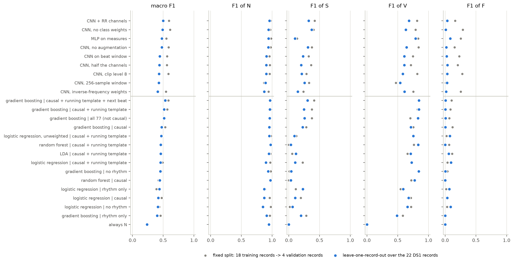
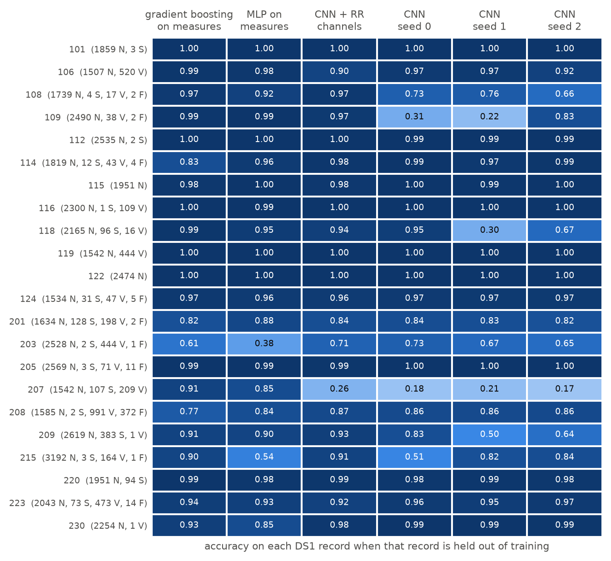
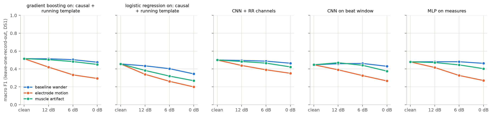

# Exploratory model tests on DS1 (2026-10-06)

Working notes, not report text and not final results. Everything here uses the 22 DS1 records only; DS2 was not read.
The purpose is to see what the baseline and the candidate edge models can realistically do before the success
criteria, risks and data-preparation choices of Submission 1 are written down.

**Note (2026-10-07):** record 201 has since been excluded from training and validation because it shares its subject
with DS2 record 202. The runs below were made before that and include it among the 22 DS1 records.

## What was run

**Protocol.** Leave-one-record-out: each of the 22 DS1 records is predicted by a model trained on the other 21, and
the predictions of all records are pooled before the metrics are computed. For comparison, the project's fixed split
(18 training records, 4 validation records) was run as well.

**Baselines** (`src/explore_baselines.py`): logistic regression, LDA, random forest and gradient boosting on the signal
measures of `src/features.py`, with six feature sets. "Causal" leaves out the nine measures a device cannot compute at
decision time; "running template" adds causal replacements for the five whole-record measures, using the median of the
previous 32 beats as reference.

**Neural candidates** (`src/explore_edge_models.py`), all built from layers the MAX78002 toolchain supports:
- CNN on the 512-sample beat window: `ECGNet` from `src/model.py` with the settings of `configs/train.yaml`, 41,156 parameters.
- CNN + RR channels: the same network with three extra constant input channels (previous RR interval, its ratio to the local mean, the local mean).
- MLP on measures: fully connected network 73 -> 64 -> 32 -> 4 on the causal measures, 6,948 parameters.
- One-change variants of the CNN: no class weights, full inverse-frequency weights, no augmentation, clip level 8, 256-sample window, half the channels.

Every network was trained for 20 epochs with cosine learning-rate decay and no early stopping, so no held-out data
chose the model that was scored.

**Noise.** Each fold's model was also scored on its held-out record with NSTDB noise at 12, 6 and 0 dB (SNR as defined
in `src/noise.py`), using the training half of the noise records so the evaluation half stays unused.

## Results on clean data (leave-one-record-out, pooled over all 50,976 DS1 beats)

| Model | Parameters | Accuracy | Macro F1 | F1 N | F1 S | F1 V | F1 F |
|---|---|---|---|---|---|---|---|
| Always N | - | 0.899 | 0.237 | 0.95 | 0.00 | 0.00 | 0.00 |
| Logistic regression, measures (causal + running template) | - | 0.812 | 0.456 | 0.90 | 0.10 | 0.73 | 0.10 |
| Random forest, same measures | - | 0.952 | 0.461 | 0.98 | 0.03 | 0.83 | 0.00 |
| Gradient boosting, causal measures only | - | 0.906 | 0.474 | 0.95 | 0.23 | 0.71 | 0.00 |
| Gradient boosting, causal + running template | - | 0.924 | 0.515 | 0.96 | 0.25 | 0.85 | 0.01 |
| Gradient boosting, same without the rhythm measures | - | 0.877 | 0.454 | 0.94 | 0.04 | 0.84 | 0.00 |
| MLP on measures | 6,948 | 0.888 | 0.479 | 0.94 | 0.10 | 0.79 | 0.08 |
| CNN on beat window (mean of 3 seeds) | 41,156 | 0.839 | 0.443 | 0.91 | 0.23 | 0.61 | 0.03 |
| CNN + RR channels | 41,396 | 0.914 | 0.500 | 0.96 | 0.32 | 0.68 | 0.03 |

The three CNN seeds gave macro F1 0.419, 0.447 and 0.463. Differences smaller than about 0.05 between two runs are
therefore not evidence of anything. All rows, including precision and recall, are in `results/exploration/summary_clean.csv`.



## Findings

1. **No model gets above 0.53 macro F1 on unseen DS1 patients.** The floor (always N) is 0.24. The plain CNN has a lower
   accuracy than always answering N (0.84 against 0.90), because it calls thousands of normal beats S or V.
2. **F is not learned by anything.** F1 for F is at most 0.10. When record 208 is held out, its 372 F beats are
   predicted as N (118), S (50) or V (204) by gradient boosting and never as F: the other 21 records contain 42 F beats.
3. **The errors sit in a few patients, and which ones fail is unstable.** Median accuracy per record is 0.97, and ten
   records are above 0.95 in every CNN run. But record 109 (left bundle branch block throughout) scores 0.31, 0.22 and
   0.83 in three CNN runs that differ only in the random seed, and record 118 scores 0.95, 0.30 and 0.67. Record 207
   (bundle branch block beats with inverted QRS) fails in all three seeds (0.17-0.21) and stays below 0.5 in every CNN
   variant, while the measure-based models handle it (0.85-0.91). In CNN seed 0, 3,226 N beats are called V (1,405 of them in record 207) and 3,358 are called S
   (1,513 in record 215, the fastest heart rate).

   

4. **The fixed validation split is optimistic and noisy.** Every CNN variant scores higher on the four validation
   records than in leave-one-record-out (plain CNN 0.56 against 0.44). During one training run the validation macro F1
   moved between 0.48 and 0.59 from epoch to epoch. A quarter of the validation beats are record 109, so the
   validation score depends heavily on whether that one patient happens to work.
5. **Rhythm information is what S needs.** Removing the rhythm measures drops gradient boosting's F1 for S from 0.25 to
   0.04. Giving the CNN the RR values as extra channels raises accuracy from 0.84 to 0.91 and S precision from 0.15 to
   0.30, and repairs records 109 and 215 (single seed, so suggestive only).
6. **Patient-relative measures can be made causal.** With a running template from the previous 32 beats, V precision
   rises from 0.59 to 0.78, and the result (0.515) equals the version that uses the whole record (0.514).
7. **Stronger class weighting did not help.** For the CNN: no weights 0.490, square-root weights 0.443, inverse-frequency
   weights 0.412, with accuracy falling from 0.89 to 0.78. The same ordering appears on the fixed split. Weighting buys
   minority recall with a larger loss of precision.
8. **Clip level, augmentation, model size and window length show no clear effect on clean data.** Clip 8 (0.433), no
   augmentation (0.478), half the channels (0.437, 10,980 parameters) and the 256-sample window (0.430) are all within
   or close to the run-to-run spread of the reference CNN (0.419-0.463). The short window does have a lower median record accuracy (0.94 against 0.97).
9. **Electrode-motion noise is the hard condition.** Macro F1 of the CNN: clean 0.447; baseline wander 0.458 / 0.462 /
   0.430 at 12 / 6 / 0 dB; muscle artifact 0.470 / 0.441 / 0.376; electrode motion 0.390 / 0.326 / 0.266. At 0 dB of
   electrode motion the CNN is close to the always-N floor. Models with rhythm inputs degrade less (CNN + RR 0.351 at
   0 dB), but only because the beat positions come from the annotations and stay perfect under noise.

   

## Follow-up: normalizing for heart rate

Question: would normalizing for heart rate help, is it already in the measures, or would it hurt?
Checked with `src/explore_hr_normalization.py` (DS1 only).

Separability from N by the single measure (AUC, pooled over DS1 / within records):

| Measure | S pooled | S within | V pooled | V within |
|---|---|---|---|---|
| Previous RR interval, absolute | 0.92 | 0.99 | 0.88 | 0.93 |
| Ratio to the mean of the last 10 intervals, current one included (`rr_pre_ratio` as it is now) | 0.84 | 0.90 | 0.94 | 0.97 |
| Ratio to the median of the previous 32 intervals | 0.88 | 0.95 | 0.92 | 0.97 |
| Ratio to the median of the previous 128 intervals | 0.95 | 0.98 | 0.93 | 0.98 |
| Ratio to the median of the whole record (not causal) | 0.98 | 0.99 | 0.87 | 0.93 |

- **The absolute RR interval is confounded with the patient's heart rate.** In record 215 (112 bpm), 95 % of the normal
  beats have a previous RR below 0.6 s, close to the S median of 0.49 s; none has a ratio below 0.85. This is the record
  where the CNN called 1,513 normal beats S.
- **The ratio in the measures today is a weak normalization.** Its reference is short and contains the beat itself, so
  it follows runs of ectopic beats: in record 209 only 40 % of the S beats have a ratio below 0.85, although all have a
  previous RR below 0.6 s. A long, robust reference (median of 128 intervals) raises that to 75 % and beats the absolute
  interval for S.
- **S and V prefer different references.** V beats are usually isolated, so a short reference is best; S beats often
  come in runs, so a long one is. A model should get the absolute interval and both kinds of ratio.
- **In a classifier it helps.** Gradient boosting, leave-one-record-out: without any ratio macro F1 0.482 (F1 of S
  0.15); with `rr_pre_ratio` only 0.515 (0.25); with the two long-reference ratios as well 0.540 (0.33, S precision
  0.18 -> 0.28).
- **The shape of the beat should not be normalized for heart rate.** Among normal beats the QRS width is unrelated to
  the heart rate (rank correlation +0.08 inside a record, +0.11 between records). Stretching the time axis of the beat
  window by heart rate would make QRS width depend on heart rate and blur the main cue for V.

**Outcome (2026-10-06):** the ratios to the median of the previous 32 and 128 intervals were added to `src/features.py`
as `rr_pre_ratio_32` and `rr_pre_ratio_128` (79 measures in total). The baseline and neural runs in the sections above
were made before that and do not include them; with them, the reference gradient boosting baseline is at 0.540.

## Follow-up: causal instead of zero-phase filter (2026-10-07)

Question: would preparing the data with a causal band-pass filter, as a device has to, help accuracy and F1?
Checked with leave-one-record-out over the 21 development records (record 201 excluded).

| Model | Filter | Accuracy | Macro F1 | F1 S | F1 V |
|---|---|---|---|---|---|
| Gradient boosting on measures (`src/explore_causal_filter.py`) | zero-phase | 0.944 | 0.540 | 0.31 | 0.87 |
| Gradient boosting on measures | causal | 0.944 | 0.549 | 0.35 | 0.85 |
| CNN on beat window, mean of 3 seeds (`results/exploration/causal_filter/`) | zero-phase | 0.852 | 0.465 | 0.35 | 0.57 |
| CNN on beat window, mean of 3 seeds | causal | 0.793 | 0.413 | 0.27 | 0.47 |

- **It does not help.** For the measures it makes no difference. For the CNN it hurts: the three causal runs (macro F1
  0.404-0.420) all lie below the three zero-phase runs (0.433-0.482), mainly through more normal beats called V
  (V precision 0.41 -> 0.32).
- **Why the CNN is affected and the measures are not.** The causal filter moves the largest deflection of the QRS by
  4 samples (11 ms) relative to the annotation and distorts the slow waves; the CNN works on the wave shape directly.
- **Where the loss sits.** In the records that were already unstable, above all the two bundle branch block records:
  mean accuracy over the three seeds falls from 0.53 to 0.06 in record 109 and from 0.80 to 0.45 in record 118.
  Fifteen of the 21 records change by less than 0.05.
- **Consequence.** The zero-phase filter stays for the prepared data. But a device cannot use it, so the drop of the
  CNN is a preview of a real deployment cost. Task 2 should look at ways to reduce it: windows aligned to the filtered
  peak, a linear-phase filter with a fixed delay, or training on causally filtered data from the start.

## What this suggests for the Submission 1 report

- **1.4 Success criteria.** A macro F1 around 0.45-0.55 is what simple models reach on unseen DS1 patients; the per-class
  figures of de Chazal et al. correspond to roughly 0.6 on DS2 (my calculation; check against the paper before citing). A threshold far above that would be a wish, not a criterion. For F, a reported
  value without a pass threshold, or a very modest one, is the defensible choice. For noise, electrode motion should
  be the stated worst case; the CNN loses about 13 %, 27 % and 40 % of its macro F1 at 12, 6 and 0 dB.
- **1.6 Risks.** Three risks now have numbers: F cannot be learned from one patient; a few atypical patients (bundle
  branch block, fast rhythm, record 203) decide the pooled result; model selection on four validation records is
  selection on noise. Mitigation for the last: record-grouped cross-validation on DS1 and more than one seed.
- **1.2 and 3.3 Input.** RR information as an explicit input is supported by the data, both as measures and as extra
  CNN channels. Measure-based models are at least as good as the CNN here and more stable across patients.
- **3.6 Class imbalance.** The default square-root class weights are not supported by these runs; no weighting was at
  least as good. Whatever is chosen should be justified with precision as well as recall.
- **3.4 Clip level and 3.7 augmentation.** Neither can be justified by a measured benefit on clean data so far.
  Augmentation was not tested under noise.

## Limits of these runs

- One seed per configuration except the reference CNN (three). No hyperparameter tuning, fixed 20 epochs.
- The pooled metrics are dominated by three to five records, so small differences between configurations mean little.
- Measures and RR channels use the annotated beat positions; a device would use a QRS detector.
- Nothing was run through the ai8x toolchain: no quantization-aware training, no INT8 results, no synthesis.
- DS2 is untouched, so none of this says how the final test will come out. In DS2 most S beats are in record 232 and
  most F beats in record 213, so the test result will depend heavily on those two patients.

## Reproduce

```bash
python src/explore_baselines.py --jobs 4                                     # about 25 min on 4 cores
python src/explore_edge_models.py --variant cnn --protocol loro --noise      # about 4 min per variant on a GPU
python src/explore_summary.py                                                # tables and figures
```

Run one training process at a time: each needs about 3.3 GB of memory. Outputs are in `results/exploration/`.

# Baseline experiments (2026-10-14, Task 2)

Exploration for report section 4.1 and for the choice of the edge model. Everything is cross-validated
leave-one-record-out over the 21 development records (DS1 without record 201); predictions of all records are
pooled and scored once. DS2 was not read. Noisy held-out records use the "cv" part of the noise records, noise
augmentation the "train" part (`noise.parts`). Code: `src/explore_ideas.py`; results:
`results/exploration/ideas/` (one CSV per group, per-record CSVs, predictions). 64 configurations were run in two
rounds, so the best single score is optimistic: it was picked out of many on the same 21 patients.

"Reference measures" are the 75 causal measures (`src/features.py` without the measures that need the next beat or
the whole record, plus the running-template comparisons). "Patient-relative" replaces the absolute morphology
measures by their deviation from the median of the patient's previous 32 beats, and keeps the rhythm ratios and
template comparisons (75 measures).

## How uncertain the numbers are (read this first)

- **Random seed.** The same gradient-boosting configuration gives macro F1 0.553, 0.554, 0.561 and 0.584 with four
  seeds (the only random part is the 10 % of the training beats that early stopping sets aside). The F1 of F moves
  between 0.01 and 0.19 with the seed alone.
- **Patients.** Resampling the 21 patients (bootstrap) gives a 95 % interval of about +-0.08 around every macro F1,
  for example 0.48-0.64 for gradient boosting.
- **Pairwise.** None of the main comparisons is clear: gradient boosting minus logistic regression +0.044 (95 %
  interval -0.05 to +0.13), minus random forest +0.015 (-0.02 to +0.05), patient-relative minus reference measures
  +0.007 (-0.04 to +0.08).

Only differences far above 0.05 deserve belief. Single runs on this data can mislead in either direction.

## Results on clean held-out records

| Model | Balancing | Measures | Macro F1 | Accuracy | S precision / recall | V precision / recall | F1 of F |
|---|---|---|---|---|---|---|---|
| Always N | - | - | 0.237 | 0.899 | - / 0 | - / 0 | 0 |
| Gradient boosting (4 seeds) | none | reference | 0.553-0.584 | 0.95 | 0.33-0.40 / 0.27-0.31 | 0.86-0.88 / 0.85-0.90 | 0.01-0.14 |
| Gradient boosting | square-root weights | reference | 0.556 | 0.952 | 0.33 / 0.36 | 0.85 / 0.94 | 0.01 |
| Gradient boosting | inverse weights | reference | 0.538 | 0.944 | 0.27 / 0.37 | 0.80 / 0.94 | 0.01 |
| Gradient boosting | balanced sampling | reference | 0.544 | 0.944 | 0.28 / 0.41 | 0.80 / 0.95 | 0.01 |
| Gradient boosting (4 seeds) | none | patient-relative | 0.550-0.581 | 0.95 | 0.33-0.34 / 0.30-0.34 | 0.89-0.90 / 0.78-0.86 | 0.03-0.19 |
| Gradient boosting | square-root weights | patient-relative | 0.565 | 0.955 | 0.34 / 0.40 | 0.89 / 0.89 | 0.02 |
| Random forest | inverse weights | reference | 0.535 | 0.952 | 0.37 / 0.26 | 0.78 / 0.95 | 0.00 |
| Linear SVM | inverse weights | reference | 0.515 | 0.850 | 0.10 / 0.51 | 0.74 / 0.89 | 0.16 |
| Logistic regression | inverse weights | reference | 0.506 | 0.849 | 0.10 / 0.46 | 0.72 / 0.89 | 0.14 |
| Logistic regression | inverse weights | patient-relative | 0.532 | 0.879 | 0.15 / 0.73 | 0.77 / 0.88 | 0.13 |
| Small MLP (64-32) | balanced sampling | patient-relative | 0.543 | 0.926 | 0.22 / 0.50 | 0.76 / 0.88 | 0.09 |
| RBF SVM (Nystroem) | inverse weights | reference | 0.499 | 0.834 | 0.11 / 0.39 | 0.48 / 0.92 | 0.29 |
| Naive Bayes, LDA, k-NN, extra trees | various | reference | 0.43-0.51 | 0.76-0.94 | | | |

## Findings

1. **Gradient boosting on the measures is the strongest baseline** (0.55-0.58), ahead of random forest (0.535), the
   linear models (0.47-0.53), a small MLP (0.48-0.54), k-NN (0.43-0.45) and extra trees (0.43). The gaps to random
   forest and logistic regression are within the uncertainty above.
2. **Class weights do not help gradient boosting** (none and square root 0.55-0.58, inverse weights and balanced
   sampling 0.54). They help the linear models (logistic regression 0.485 -> 0.506), where they trade precision for
   recall: with inverse weights logistic regression finds 46-73 % of the S beats at a precision of 0.10-0.15.
3. **Both kinds of information are needed.** Rhythm measures alone give 0.433, morphology alone 0.446, both 0.538
   (inverse weights). Without rhythm the F1 of S falls to 0.03; without morphology the F1 of V falls to 0.55. The
   running-template comparisons add 0.04 (0.501 -> 0.538).
4. **Measures relative to the patient raise the recall of S** (0.37 -> 0.45-0.54 with inverse weights; 0.30 -> 0.40
   with square-root weights) at about the same precision, but the macro F1 does not change beyond the seed spread.
   Deviations from the whole record (not causal) are no better than deviations from the previous 32 beats.
5. **Ideas that did not help:** waiting for the next beat (0.537), the raw waveform instead of or next to the measures
   (0.487 and 0.540), the 20 best measures per fold (0.530), stronger regularization, slower learning, no early
   stopping, two stages (N against the rest, then S/V/F), averaging seeds or models (0.538-0.574), the previous beat's
   values as context (0.563), and adjusting the decision thresholds on the other 20 records (+0.005).
6. **Recorded-noise augmentation is the clearest gain of all experiments.** Without it, electrode motion destroys the
   S class (recall 0.37 -> 0.06, 0.01, 0.00 at 12, 6, 0 dB) and many noisy beats are called V (V precision 0.80 ->
   0.52, 0.33, 0.23). With one noisy copy of every training record per noise type (SNR drawn from 0-18 dB):

   | Gradient boosting, inverse weights, reference | clean | em 12 dB | em 6 dB | em 0 dB |
   |---|---|---|---|---|
   | without augmentation | 0.538 | 0.431 | 0.358 | 0.310 |
   | with augmentation | 0.541 | 0.506 | 0.472 | 0.435 |

   The macro F1 on clean records does not suffer, and the drop at 12 dB falls from 0.11 to 0.03 (criterion: 0.10).
   Baseline wander and muscle artifact cost less in both cases. The same holds for the patient-relative measures
   without balancing (em 12/6/0 dB 0.513 / 0.494 / 0.469 against a clean 0.554).
7. **Patients.** Gradient boosting handles the bundle branch block records that defeated the CNN (109: 0.99, 207:
   0.91). Its weakest records are 203 (0.75-0.78, noisy), 208 (0.76-0.83, the F record) and 209 (0.90).
8. **F stays unsolved.** The best F1 for F (0.29) comes from an RBF SVM with inverse weights, which finds 76 % of the F
   beats at a precision of 0.18; gradient boosting finds 1-12 %.

## Against the success criteria (cross-validated, not DS2)

- Macro F1 >= 0.50: met by all gradient-boosting variants (0.54-0.58).
- S recall >= 0.40: not met by gradient boosting without weights (0.27-0.34); met with square-root weights and
  patient-relative measures (0.40) and with noise augmentation (0.40-0.48).
- V recall >= 0.70: met (0.76-0.95).
- Noise drop <= 0.10 at 12 dB and <= 0.25 at 6 dB: met only with noise augmentation.

## Suggestions

- **Baseline for 4.1:** gradient boosting on the reference measures, no class weights, reported as the mean and range
  over three seeds (0.553-0.561 for seeds 0-2), not the best seed. Logistic regression with inverse weights (0.506)
  is the simpler alternative if "simple" matters more than strength; the edge model then has a lower bar to pass.
- **Note the bar for the edge model.** The CNN on the beat window reached 0.465 (mean of three seeds, earlier run).
  A network that cannot beat 0.55 on the measures would fail the criterion "higher than the simple baseline" if
  gradient boosting is that baseline. A small network on the measures, or a CNN with rhythm inputs, are the
  candidates to test next, with noise augmentation from the start.
- **Use noise augmentation** for whatever model is chosen.
- **Use three seeds and the bootstrap interval** before believing any difference; decide on a short list in advance
  (risk table, section 1.6).

# Edge-model experiments (2026-10-14, Task 2)

Goal: a network that fits the MAX78002 and beats the gradient-boosting baseline (cross-validated macro F1 0.556, mean
of seeds 0-2; decision log 2026-10-14). Same protocol as the baseline experiments: leave-one-record-out over the 21
development records, pooled predictions, three seeds per configuration, DS2 not read. Code:
`src/explore_networks.py` (runner) and `src/explore_compare.py` (paired patient bootstrap against the baseline);
results: `results/exploration/networks/` (`<round>.csv`, `_per_record.csv`, `_curves.csv`, `_predictions.npz`) and
the W&B project "D7043E Edge-Ready ECG Classification" (one run per configuration and seed, grouped by round).

All networks use only MAX78002 operations (1D convolutions with kernel 5 and padding 2 on at most 64 input channels,
batch normalization, ReLU, max pooling, one linear layer). Training: AdamW (learning rate 1e-3, weight decay 1e-4),
batch 256, cosine schedule, 20 epochs (40 for networks on measures), augmentation by amplitude scaling, circular shift
(+-8 samples) and white noise. No early stopping: the held-out record is only watched, so the learning curves in
`_curves.csv` show what would have happened at other epoch counts.

Inputs tried:

- **Window**: the 512-sample beat window (ECGNet, 41k parameters).
- **Measures**: the 75 reference or patient-relative measures as the only input, through a network written as 1x1
  convolutions (19k parameters).
- **Context channels**: 15 measures (the 9 rhythm measures, the 5 running-template comparisons and the correlation
  with the previous beat), each fed as a constant extra input channel next to the window.
- **Template channel**: a second input channel holding the patient's running template, the sample-wise median of the
  previous 32 beat windows of the same record (causal). On the device the Arm core would keep the last 32 windows
  (16 KB at 8 bits) and compute the median; the accelerator then sees the current beat next to the patient's usual
  beat.

## Results on clean held-out records

Mean over three seeds (range in brackets). "P(better)" is the share of 5,000 patient-bootstrap samples in which the
configuration beats the baseline; the 95 % interval of the difference is about +-0.07 for every row.

| Round | Network | Macro F1 | Gap to baseline | P(better) | S precision / recall | V precision / recall | F1 of F |
|---|---|---|---|---|---|---|---|
| 1 | CNN, window | 0.507 (0.485-0.531) | -0.049 | 0.19 | 0.38 / 0.57 | 0.47 / 0.92 | 0.01 |
| 1 | CNN, window, square-root weights | 0.465 (0.436-0.484) | -0.091 | 0.03 | 0.21 / 0.61 | 0.46 / 0.93 | 0.02 |
| 1 | CNN, window, balanced sampling | 0.444 (0.440-0.447) | -0.111 | 0.00 | 0.21 / 0.63 | 0.38 / 0.94 | 0.02 |
| 1 | Measures (reference) | 0.488 (0.480-0.496) | -0.068 | 0.01 | 0.17 / 0.23 | 0.65 / 0.89 | 0.05 |
| 1 | Measures (patient-relative) | 0.527 (0.523-0.533) | -0.029 | 0.15 | 0.23 / 0.28 | 0.86 / 0.83 | 0.04 |
| 1 | Measures (patient-relative), square-root weights | 0.536 (0.527-0.545) | -0.020 | 0.26 | 0.22 / 0.32 | 0.84 / 0.84 | 0.08 |
| 1 | CNN, window + context channels | 0.534 (0.516-0.562) | -0.022 | 0.20 | 0.42 / 0.28 | 0.76 / 0.85 | 0.03 |
| 2 | **CNN, window + template** | **0.591 (0.589-0.594)** | **+0.035** | **0.77** | 0.60 / 0.44 | 0.81 / 0.92 | 0.01 |
| 2 | CNN, window + template + context channels | 0.532 (0.525-0.547) | -0.023 | 0.11 | 0.37 / 0.28 | 0.76 / 0.86 | 0.03 |
| 3 | CNN, window + template (repeat) | 0.584 (0.573-0.592) | +0.029 | 0.73 | 0.57 / 0.42 | 0.82 / 0.91 | 0.01 |
| 3 | ... 40 epochs | 0.574 (0.560-0.581) | +0.018 | 0.65 | 0.56 / 0.39 | 0.80 / 0.91 | 0.01 |
| 3 | ... wider (32-64-64-64-64 channels, 75k parameters) | 0.581 (0.560-0.592) | +0.025 | 0.70 | 0.62 / 0.40 | 0.79 / 0.91 | 0.01 |
| 3 | ... square-root weights | 0.580 (0.572-0.593) | +0.024 | 0.67 | 0.46 / 0.51 | 0.79 / 0.92 | 0.02 |
| 3 | ... + 9 rhythm channels | 0.518 (0.494-0.542) | -0.038 | 0.06 | 0.45 / 0.21 | 0.75 / 0.86 | 0.01 |
| 3 | ... pre-window 448 samples | 0.553 (0.550-0.559) | (other beats) | | 0.45 / 0.32 | 0.79 / 0.93 | 0.01 |
| 3 | ... recorded-noise augmentation | 0.560 (0.546-0.581) | +0.005 | 0.53 | 0.50 / 0.44 | 0.73 / 0.88 | 0.01 |

## Findings

1. **The template channel is the step that matters.** It lifts the window CNN from 0.507 to 0.584-0.591 over six
   seeds, the first network above the baseline. It mainly removes false alarms: N beats called V fall from about 3,300
   to 600 (the baseline makes about 400), N beats called S from about 790 to 180 (baseline about 400), while the CNN
   keeps finding more S beats than gradient boosting (44 % against 27-31 %). Without the template, most false V come
   from the bundle branch block records 207, 203, 109 and 118, whose normal beats are wide; with the patient's own
   template next to the beat, a wide beat that looks like all the patient's other beats is no longer suspicious.
2. **The template also stops the overfitting.** The window CNN reaches 0.556 after 3 epochs and then falls to about
   0.51 as it learns the training patients; the template CNN rises steadily (0.551 after 3 epochs, 0.580 after 10,
   0.591 after 20). Training longer (40 epochs) or wider (75k parameters) adds nothing.
3. **Measures as extra input channels hurt the template CNN** (0.532 with the 15 context measures, 0.518 with the 9
   rhythm measures). The loss is in S: on record 209, whose 383 S beats come mostly in runs of supraventricular
   tachycardia, S recall falls from 0.60 to 0.24. Inside a run the rhythm ratios to the recent median soon look normal
   again, and a network that has the ratios relies on them instead of the waveform. Without a template the context
   channels do help (0.507 -> 0.534), because they carry the patient comparison that the window alone lacks.
4. **Class weights and balanced sampling do not help** (CNN 0.507 -> 0.465 and 0.444; template CNN 0.584 -> 0.580).
   They raise S recall at a larger cost in S and V precision, as for gradient boosting.
5. **A network on the measures alone stays below gradient boosting** (0.488 reference, 0.527-0.536 patient-relative),
   the same order as the small sklearn MLP in the baseline experiments.
6. **The longer pre-window (448 samples) is worse** (0.553), not better: more of the previous beat in view does not
   replace the template, and S recall falls (0.32).
7. **Without noise augmentation the template CNN fails the noise criterion; with it, it passes.** Macro F1 under noise
   (mean of three seeds, held-out records with the "cv" part of the noise records):

   | Network | clean | em 12 dB | em 6 dB | em 0 dB | ma 12 dB | ma 6 dB | bw 12 dB | bw 6 dB |
   |---|---|---|---|---|---|---|---|---|
   | Template CNN | 0.584 | 0.446 | 0.355 | 0.278 | 0.530 | 0.464 | 0.565 | 0.539 |
   | Template CNN, noise augmentation | 0.560 | 0.507 | 0.470 | 0.401 | 0.540 | 0.498 | 0.555 | 0.543 |
   | Gradient boosting, noise augmentation (baseline experiments) | 0.538 | 0.492 | 0.473 | 0.453 | 0.514 | 0.497 | 0.528 | 0.518 |

   The electrode-motion drop at 12 dB shrinks from 0.14 to 0.05 (criterion 0.10), at 6 dB from 0.23 to 0.09
   (criterion 0.25). Unlike gradient boosting, the network pays for the augmentation on clean records (about -0.025,
   within the seed spread but in all three seeds' mean).
8. **A milder SNR range for the noisy copies removes most of that cost** (round 4). With three noise types, each epoch
   is drawn three quarters from noisy copies; drawing half from clean beats instead, or drawing the copies' SNR from
   6-24 dB instead of 0-18 dB:

   | Template CNN, noise augmentation | clean | em 12 dB | em 6 dB | em 0 dB | ma 12 dB | ma 6 dB | bw 12 dB | bw 6 dB |
   |---|---|---|---|---|---|---|---|---|
   | none (clean training) | 0.584 | 0.446 | 0.355 | 0.278 | 0.530 | 0.464 | 0.565 | 0.539 |
   | 0-18 dB, 3/4 noisy per epoch (round 3) | 0.560 | 0.507 | 0.470 | 0.401 | 0.540 | 0.498 | 0.555 | 0.543 |
   | 0-18 dB, 1/2 noisy per epoch | 0.568 | 0.513 | 0.466 | 0.399 | 0.547 | 0.502 | 0.563 | 0.551 |
   | **6-24 dB, 3/4 noisy per epoch** | **0.577** | **0.523** | 0.454 | 0.362 | **0.561** | **0.510** | **0.574** | **0.564** |
   | 6-24 dB, 1/2 noisy per epoch | 0.565 | 0.511 | 0.449 | 0.356 | 0.550 | 0.499 | 0.563 | 0.550 |

   6-24 dB keeps the clean macro F1 within 0.01 of clean training (0.577, seeds 0.567-0.591; S precision / recall
   0.59 / 0.50, V 0.70 / 0.89) and is the most robust at 12 dB for every noise type; it gives up some robustness at
   0 dB, which the criteria do not cover. Under electrode motion the losses are in S (recall 0.29 at 12 dB, 0.13 at
   6 dB) while V holds (recall 0.86 and 0.83).
9. **The same seed does not give the same result.** The template CNN with seed 0 scored 0.594 in round 2 and 0.573 in
   round 3: GPU convolutions are not bit-reproducible, and the difference grows over 20 epochs. Treat the seed spread
   (about 0.02-0.03) as the run-to-run noise.
10. **F stays unsolved** (F1 0.01-0.08 for every network). Almost all F beats are in record 208, so when 208 is held
    out the training records hold only a few dozen F beats.

## Against the success criteria (cross-validated, not DS2)

For the template CNN with noise augmentation at 6-24 dB (round 4):

| Criterion | Target | Cross-validated result |
|---|---|---|
| Macro F1, and above the baseline | >= 0.50 and > 0.556 | 0.577 (0.567-0.591); bootstrap P(better) 0.61, difference +0.021 (95 % interval -0.08 to +0.09) |
| S recall | >= 0.40 | 0.50 |
| V recall | >= 0.70 | 0.89 |
| F1 of F | reported only | 0.01 |
| Noise drop, worst type (electrode motion) | <= 0.10 at 12 dB, <= 0.25 at 6 dB | 0.054 and 0.123 |
| Parameters | <= 250k | 41,236 |
| INT8 within 0.05 of FP32, ai8x synthesis | | not tested yet |

The edge model is ahead of the baseline in every comparison so far, but by less than the patient bootstrap can
resolve on 21 patients: "higher than the baseline" on DS2 is likely, not certain.

## Suggestions

- **Candidate edge model:** ECGNet with two input channels (beat window and running template), no class weights,
  recorded-noise augmentation at 6-24 dB, 20 epochs. Next steps: port to ai8x-training (2-channel input), quantize and
  check the INT8 loss and the synthesis limits, then write the template computation for the Arm core.
- **Do not add the measures** to the template CNN, and do not use class weights.
- **Freeze the choice before DS2.** Rounds 1-4 tried 21 network configurations on the same 21 patients; the best
  cross-validated score is optimistic by about the seed spread.
